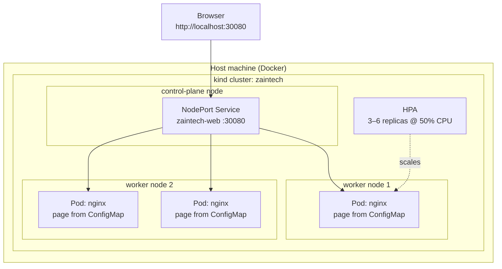

# Kubernetes Cluster Deployment — Zain Tech Automation Solutions Website

A local Kubernetes cluster built with **kind** (Kubernetes in Docker) that runs the Zain Tech Automation Solutions website on nginx — with 3 replicas, a NodePort service, a ConfigMap-driven page, a rolling update, and CPU-based autoscaling (HPA). This is a local learning and portfolio cluster: everything runs on one machine, free, with no cloud account.

## Architecture



## What this builds

- A **kind** cluster named `zaintech`: 1 control-plane + 2 worker nodes, each node a Docker container
- Host port **30080** mapped into the cluster for the NodePort service
- A dedicated namespace: `zaintech`
- An **nginx** Deployment (`nginx:alpine`), **3 replicas**, with CPU/memory requests & limits and a readiness probe
- The web page delivered from a **ConfigMap** mounted as `index.html` — no image rebuild needed to change the page
- A **NodePort Service** (30080 → 80)
- A **HorizontalPodAutoscaler** (autoscaling/v2): 3–6 replicas at 50% CPU utilization
- A **rolling update** path: swap the ConfigMap to Version 2, restart, watch the rollout, roll back if needed
- `verify.sh` — an end-to-end check of nodes, pods, the live page, and the HPA

## Prerequisites

- **Docker** installed and running
- **kind** and **kubectl** installed (Linux, official curl installs):

```bash
# kind
[ $(uname -m) = x86_64 ] && curl -Lo ./kind https://kind.sigs.k8s.io/dl/v0.24.0/kind-linux-amd64
chmod +x ./kind
sudo mv ./kind /usr/local/bin/kind

# kubectl
curl -LO "https://dl.k8s.io/release/$(curl -L -s https://dl.k8s.io/release/stable.txt)/bin/linux/amd64/kubectl"
chmod +x ./kubectl
sudo mv ./kubectl /usr/local/bin/kubectl
```

## Run it

```bash
git clone https://github.com/zain-ul-abadeen-1213/kubernetes-cluster-deployment.git
cd kubernetes-cluster-deployment
bash scripts/setup.sh
```

The setup script creates the cluster, applies the namespace and all manifests, and waits for the rollout to finish. Then look around:

```bash
kubectl get nodes
kubectl get pods -n zaintech
kubectl get svc,hpa -n zaintech
```

Open the site: **http://localhost:30080** — you should see the Zain Tech Automation Solutions page, "Deployed on Kubernetes — Version 1".

Run the verification:

```bash
bash verify.sh
```

## Rolling update to Version 2

The page text lives in a ConfigMap, so an update means: apply the Version 2 ConfigMap, restart the deployment, and watch Kubernetes replace the pods one by one with no downtime.

```bash
bash scripts/update-to-v2.sh
```

…or by hand:

```bash
kubectl apply -f configmap-v2.yaml
kubectl rollout restart deployment/zaintech-web -n zaintech
kubectl rollout status deployment/zaintech-web -n zaintech
```

Refresh http://localhost:30080 — the page now shows **Version 2**. Changed your mind? Roll back:

```bash
kubectl rollout undo deployment/zaintech-web -n zaintech
```

## HPA demo — watch it scale under load

The HPA needs CPU metrics, which a fresh kind cluster does not have. Install the metrics server (the `--kubelet-insecure-tls` flag is required on kind):

```bash
kubectl apply -f https://github.com/kubernetes-sigs/metrics-server/releases/latest/download/components.yaml
kubectl patch deployment metrics-server -n kube-system --type=json \
  -p='[{"op":"add","path":"/spec/template/spec/containers/0/args/-","value":"--kubelet-insecure-tls"}]'
```

Wait a minute, confirm metrics are flowing (`kubectl top pods -n zaintech`), then generate load from inside the cluster and watch the HPA react in a second terminal:

```bash
# load generator — busybox hammering the service from inside the cluster
kubectl run -n zaintech load-generator --rm -i --restart=Never --image=busybox:1.36 -- \
  sh -c 'while true; do wget -q -O- http://zaintech-web > /dev/null; done'

# in another terminal
kubectl get hpa -n zaintech -w
```

CPU climbs past 50%, the HPA adds pods (up to 6), and when the load generator is stopped (Ctrl+C), it scales back down to 3.

## Expected results

- `kubectl get nodes` shows 3 nodes, all **Ready** (1 control-plane, 2 workers).
- 3 `zaintech-web` pods **Running** in namespace `zaintech`, spread across the workers.
- http://localhost:30080 serves the branded page ("Version 1", later "Version 2" after the update).
- `bash verify.sh` finishes with all checks PASS.
- Under load, the HPA scales the deployment from 3 up toward 6 replicas and back down when the load stops.

## Verified run

_Pending — this section will be completed with the real local run results, screenshots, and verification output after the cluster has been executed end to end._

## Cleanup

Delete the whole cluster (all nodes are just Docker containers):

```bash
kind delete cluster --name zaintech
```
